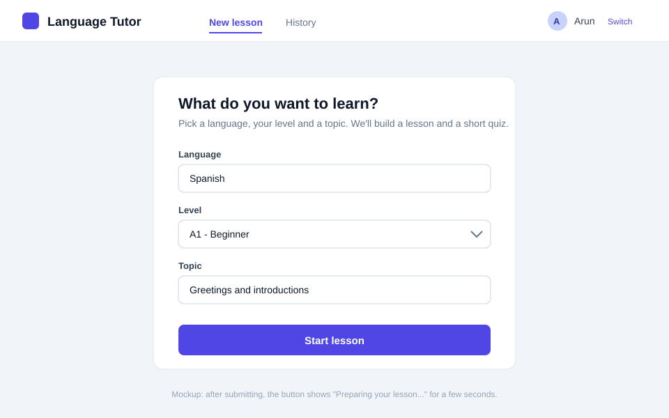
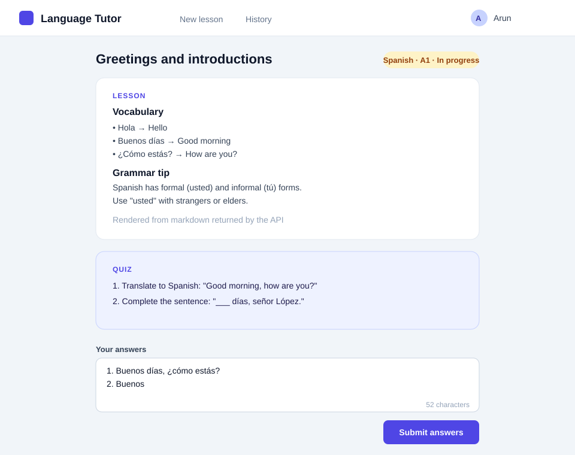
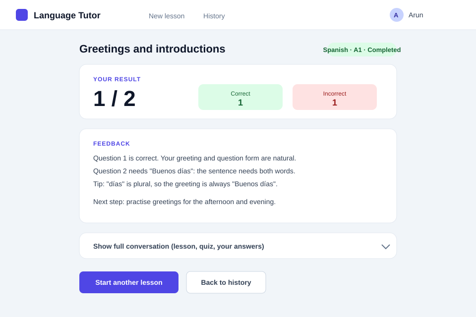
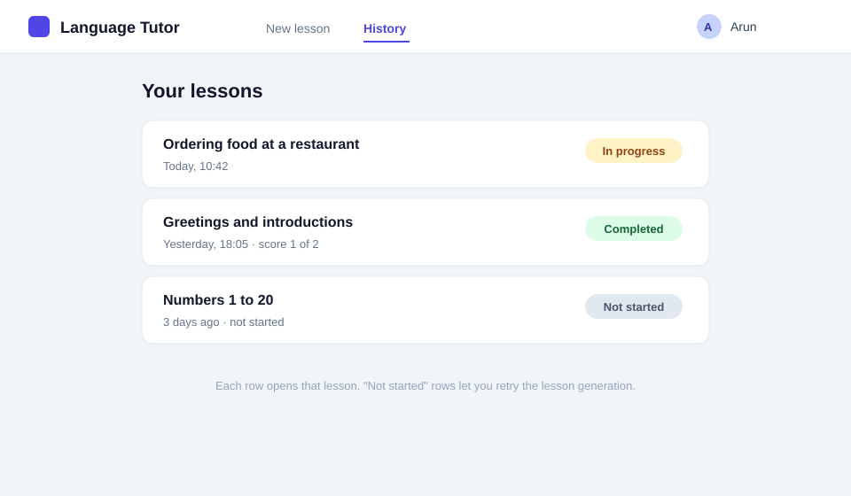

# Frontend Tasks

A React + Vite + TypeScript frontend for the agent orchestrator API. Work through the tasks in order. Each one ends with checks you can run or click through, so you know it is done before moving on.

Tick a box when the task is finished: `- [x]`.

## Stack

| Concern          | Choice                                                                |
| ---------------- | --------------------------------------------------------------------- |
| Build tool       | Vite                                                                  |
| Language         | TypeScript (strict)                                                   |
| UI               | React                                                                 |
| Routing          | React Router                                                          |
| Server state     | TanStack Query                                                        |
| API client       | `openapi-typescript` + `openapi-fetch` (types generated from FastAPI) |
| Styling          | Tailwind CSS                                                          |
| Markdown         | `react-markdown` (lessons and feedback arrive as markdown text)       |
| Tests (optional) | Vitest, React Testing Library, MSW                                    |

## Backend reference

Start the backend from `01-mini-projects/agent-orchestrator` with `python run.py` (Postgres must be running). It serves on `http://localhost:8000`, with interactive docs at `/docs` and the schema at `/openapi.json`.

| Method | Path                           | Body                                                   | Success response                                      |
| ------ | ------------------------------ | ------------------------------------------------------ | ----------------------------------------------------- |
| POST   | `/users`                       | `{ name? }`                                            | `201 { id, name }`                                    |
| GET    | `/users/{user_id}`             |                                                        | `{ id, name }`                                        |
| POST   | `/sessions`                    | `{ id, user_id, topic }` (`id` is a UUID you generate) | `201 { id, user_id, topic, status }`                  |
| POST   | `/tutor/start`                 | `{ session_id, level, language, lesson }`              | `{ session_id, lesson, quiz }`                        |
| POST   | `/tutor/answer`                | `{ session_id, answer }`                               | `{ session_id, score, correct, incorrect, feedback }` |
| GET    | `/tutor/{session_id}/messages` |                                                        | `[{ id, role, content, created_at }]`                 |

Behaviour to design around:

- `/tutor/start` and `/tutor/answer` call an LLM and can take 5 to 30 seconds. Every screen that triggers them needs a clear loading state and must block double submits.
- The quiz is one block of markdown containing two questions. The answer is one text field.
- Errors return `{ "detail": "..." }`. `404` means the session does not exist. `409` means the lesson already started, no quiz is waiting for an answer, or another request for the session is still running. `422` means a validation error.
- A session's messages tell you where it is: 0 messages means not started, 2 means the quiz is waiting for an answer, 4 means finished. The session `status` is `in_progress` or `completed`.
- There is no authentication. The app keeps a "current user" in the browser.

## Screen mockups

Rough layouts, not final styling. The SVG files are in `docs/mockups/`. Each task below names the screen it builds.

### Screen 1: New lesson (task 7)

The home page is one card with language, level and topic fields and a "Start lesson" button. While the backend works, the button shows "Preparing your lesson...".



### Screen 2: Lesson and quiz (tasks 8 and 9)

The lesson appears as formatted text. The quiz sits in a tinted card below it. A single text box takes both answers, with a Submit button.



### Screen 3: Feedback (task 10)

A score card shows the score with correct and incorrect counts. The tutor's feedback text sits below it. The full conversation can be expanded, and a button starts another lesson.



### Screen 4: History (tasks 11 and 12)

A list of past lessons, each with a status badge: In progress, Completed or Not started. Clicking a row opens that lesson.



### Not drawn

- **First visit (task 6):** a small "What should we call you?" form shown before the home page.
- **Error states (task 13):** inline messages next to the action that failed.
- **Mobile (task 14):** the same layout in a single column.

## Target layout

```
agent-frontend/
  src/
    api/          generated types, client, query hooks
    components/   shared UI (Button, Spinner, Markdown, ErrorMessage, ...)
    features/
      user/       identity (create or pick a user)
      lesson/     new-lesson form, lesson view, quiz and answer, feedback
      history/    past sessions and conversation view
    routes/       route components and router config
    lib/          small helpers (uuid, error mapping, storage)
  docs/mockups/ screen mockups (SVG)
  .env.example
```

---

## Phase 0: Backend prerequisites

### [x] B1. Enable CORS on the backend

The browser will call `http://localhost:8000` from `http://localhost:5173`, which needs CORS.

- Add `CORSMiddleware` in `app/main.py`.
- Read the allowed origins from an env var (`CORS_ORIGINS`, comma separated, default `http://localhost:5173`). Do not use `*`.
- Add the variable to `.env.example` and the README.

Done when: a request from the Vite dev server to `/health` succeeds in the browser, with no CORS error in the console.

### [x] B2. Add the read endpoints the frontend needs

The history screens need data the API does not expose yet.

- `GET /sessions/{session_id}` returns one session.
- `GET /users/{user_id}/sessions` returns that user's sessions, newest first. `SessionRepository.get_all_by_user_id` already exists. Order by `created_at` descending.
- Return 404 when the user or session does not exist.

Done when: both endpoints appear in `/docs` and return the expected data for a session created through the API.

> You can ask Kiro to do B1 and B2 in this repo. Tasks 1 onwards happen in `agent-frontend`.

---

## Phase 1: Foundation

### [ ] 1. Scaffold the project

From `01-mini-projects/agent-frontend`:

```powershell
npm create vite@latest . -- --template react-ts
npm install
npm run dev
```

- Keep the existing `.gitkeep` or remove it once real files exist.
- Remove the Vite demo content (`App.css`, the logo, the counter).
- Make sure `node_modules` and `dist` are git-ignored.

Done when: `npm run dev` serves a blank page at http://localhost:5173 with no console errors.

### [ ] 2. Tooling and configuration

- Turn on TypeScript `strict` and add a `@/` path alias for `src/` (in `tsconfig` and `vite.config.ts`).
- Install and configure Tailwind CSS by following its current Vite guide.
- Add ESLint (the Vite template includes it) and Prettier. Add `lint`, `format` and `typecheck` scripts.
- Add `.env.example` with `VITE_API_BASE_URL=http://localhost:8000`. Read it in one place, `src/lib/config.ts`, and fail loudly if it is missing.

Done when: `npm run lint`, `npm run typecheck` and `npm run build` all pass, and a Tailwind class visibly styles an element.

### [ ] 3. Typed API client

- Install `openapi-typescript` and `openapi-fetch`.
- Add the script `"gen:api": "openapi-typescript http://localhost:8000/openapi.json -o src/api/schema.d.ts"`.
- Create `src/api/client.ts` exporting a single client created with `createClient<paths>({ baseUrl })`.
- Commit the generated `schema.d.ts`. Regenerate it whenever the backend changes.

Done when: calling `client.GET("/health")` from a scratch component returns `{ status: "ok" }`, and a wrong path or body field is a TypeScript error.

### [ ] 4. App shell, routing and query setup

- Install React Router and TanStack Query. Wrap the app in `QueryClientProvider` and `RouterProvider`.
- Create a layout with a header (app name, current user, navigation) and a content area.
- Routes:
  - `/` home or new lesson
  - `/sessions` history
  - `/sessions/:sessionId` one lesson or conversation
  - `*` not-found page
- Add a top-level error boundary route element.

Done when: you can navigate between the placeholder pages and an unknown URL shows the not-found page.

### [ ] 5. Shared UI components

Build small, reusable pieces first: `Button` (with a loading state), `Spinner`, `Card`, `TextField`, `SelectField`, `ErrorMessage`, and `Markdown` (wrapping `react-markdown`).

- `Markdown` must not render raw HTML.
- Every input needs a visible label.

Done when: a scratch page shows each component, and `Button` ignores clicks while loading.

---

## Phase 2: Identity

### [ ] 6. Current user

The API has no login, so the browser remembers a user id.

- Add `src/api/users.ts` with a `useCreateUser` mutation (`POST /users`) and a `useUser(id)` query (`GET /users/{id}`).
- Store the user id in `localStorage` through a small helper in `src/lib/storage.ts`. Handle the storage being unavailable.
- On first visit, show a "What should we call you?" form (name is optional) that creates the user and stores the id.
- If the stored id returns 404 (for example the database was reset), clear it and show the form again.
- Show the user's name in the header with a "Switch user" action that clears the stored id.

Done when: the first visit asks for a name, a refresh keeps you signed in, and "Switch user" returns to the form.

---

## Phase 3: The lesson flow

### [ ] 7. Start a lesson

Form fields: `language`, `level` (a select such as A1 to C2), `lesson` (the topic, free text).

On submit, in this order:

1. Generate a UUID for the session id (`crypto.randomUUID()`).
2. `POST /sessions` with `{ id, user_id, topic }`. Use the lesson topic as `topic`.
3. `POST /tutor/start` with the session id and the form values.
4. Navigate to `/sessions/:sessionId`.

- Validate required fields before sending.
- Disable the form and show a "Preparing your lesson..." state during the request. This call can take a while.
- If step 3 fails, the session already exists. Keep the id and let the user retry. The backend continues from where it stopped when the same request is repeated.

Done when: submitting the form shows the loading state, then lands on the session page. A failed start offers a retry that works.

### [ ] 8. Lesson and quiz view

Route `/sessions/:sessionId`.

- Load the conversation with `GET /tutor/{session_id}/messages` through a `useMessages(sessionId)` query.
- With 2 messages, show the lesson (first message) and the quiz (second message) as markdown, followed by the answer form.
- Show a loading skeleton while fetching and a not-found message on 404.

Done when: opening the session after starting a lesson shows the lesson and quiz, and a hard refresh shows the same content.

### [ ] 9. Submit an answer

- A multi-line text area for the answer, with a character counter and a submit button.
- Call `POST /tutor/answer`. Disable the form and show "Checking your answer..." while waiting.
- On success, invalidate the messages query so the page re-renders with the result.
- Warn the user before leaving the page while a request is in flight.

Done when: submitting an answer shows the feedback, and the form can no longer be submitted again.

### [ ] 10. Feedback view

With 4 messages, show the whole conversation: lesson, quiz, the user's answer, and the feedback.

- Show a score summary above the feedback: score, correct count, incorrect count.
- Parse the numbers from the response of the answer call when you have it. When loading a finished session later, show only the stored feedback message.
- Add a "Start another lesson" button that goes back to `/`.

Done when: you can complete a lesson from the form to the feedback without a page reload, and reopening it later shows the same conversation.

---

## Phase 4: History

### [ ] 11. Session history

Requires B2.

- `/sessions` lists the current user's sessions, newest first. Show topic, status badge (`in_progress` or `completed`), and created date.
- Each item links to `/sessions/:sessionId`.
- Add an empty state with a link to start the first lesson.

Done when: lessons you created appear in the list and open correctly.

### [ ] 12. Resume an unfinished lesson

- For a session with 0 messages (the start request failed), show a "This lesson has not started" screen with a retry that needs the original language, level and topic. Ask for them again, with the topic prefilled from the session.
- For a session with 2 messages, the page already shows the answer form (task 8).

Done when: a session created but never started can be completed from the history page.

---

## Phase 5: Quality

### [ ] 13. Error handling

- Write one function, `src/lib/errors.ts`, that turns an API error or a network failure into a user-facing message.
- Map `404`, `409` (including the "still running" case, which should suggest waiting a moment and trying again), `422`, `5xx` and network errors.
- Show errors inline next to the action that failed, not only in the console.
- Configure TanStack Query so `4xx` responses are not retried automatically and the slow LLM mutations are never retried automatically.

Done when: stopping the backend and submitting a form shows a readable message, and the page recovers once the backend is back.

### [ ] 14. Polish and accessibility

- Responsive layout that works from phone width to desktop.
- Keyboard navigation works everywhere. Focus moves to the new content after a lesson loads. Loading and error messages are announced (`aria-live`).
- Page titles that change per route.
- Sensible empty and loading states on every screen.

Done when: you can complete the whole flow with the keyboard only, and the layout holds at 360px width.

### [ ] 15. Tests (optional)

- Vitest and React Testing Library, with MSW to mock the API.
- Cover the new-lesson form (validation and the three-call sequence), the answer form, and the error mapping function.

Done when: `npm test` passes in CI mode.

### [ ] 16. Production build and run notes

- `npm run build` produces `dist/` with no warnings.
- `npm run preview` works against the backend with `CORS_ORIGINS` set to the preview URL.
- Add a short `README.md` in this folder: install, environment variables, the two commands to run backend and frontend, and how to regenerate the API types.

Done when: someone with a fresh clone can run both services from the README alone.

---

## Later: voice

The project is aimed at a voice agent. Once the text flow works, likely next steps are microphone capture (`MediaRecorder`), speech-to-text for the answer, and text-to-speech for the lesson. These need new backend endpoints, so plan them as a separate set of tasks.
